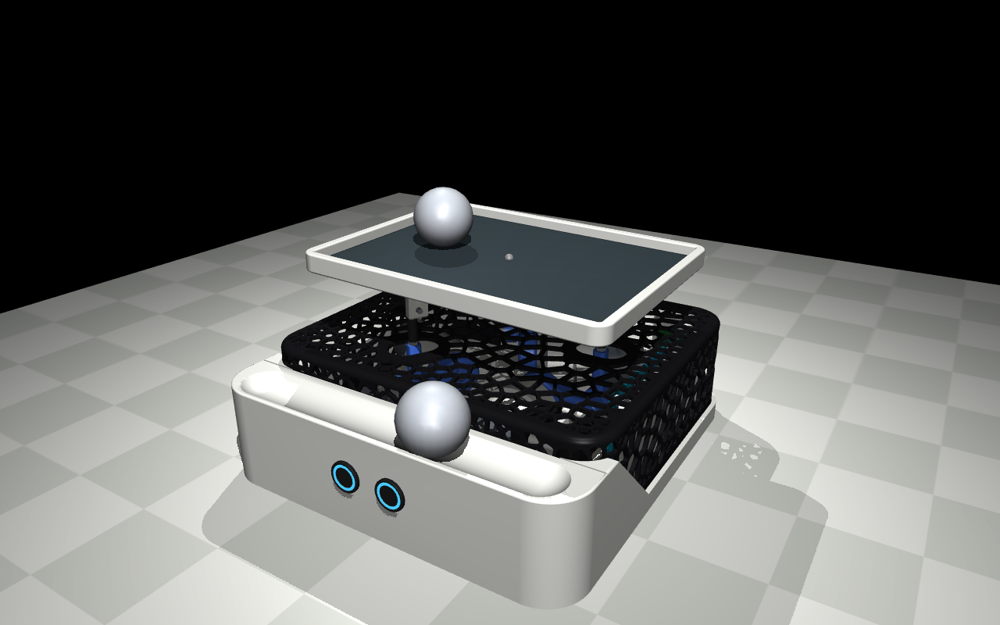
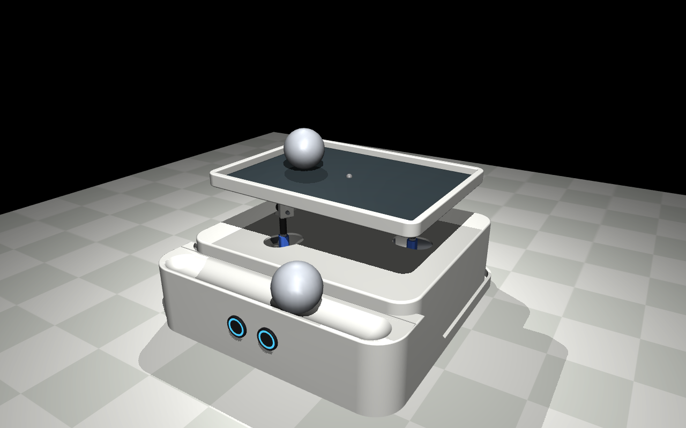
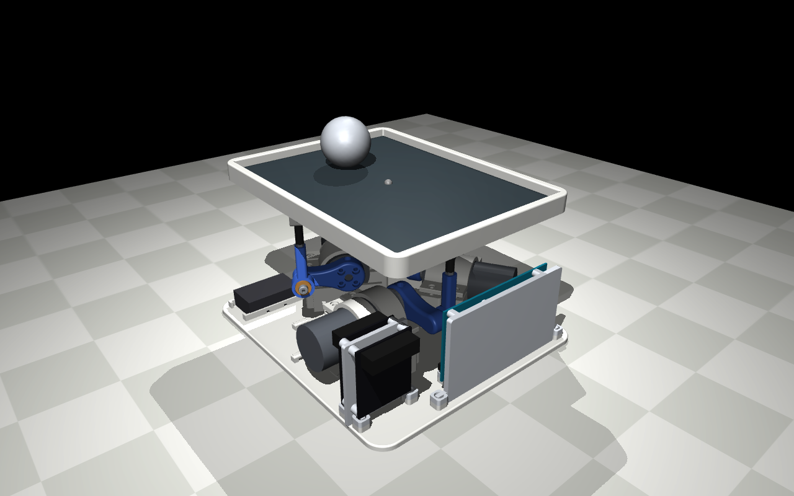
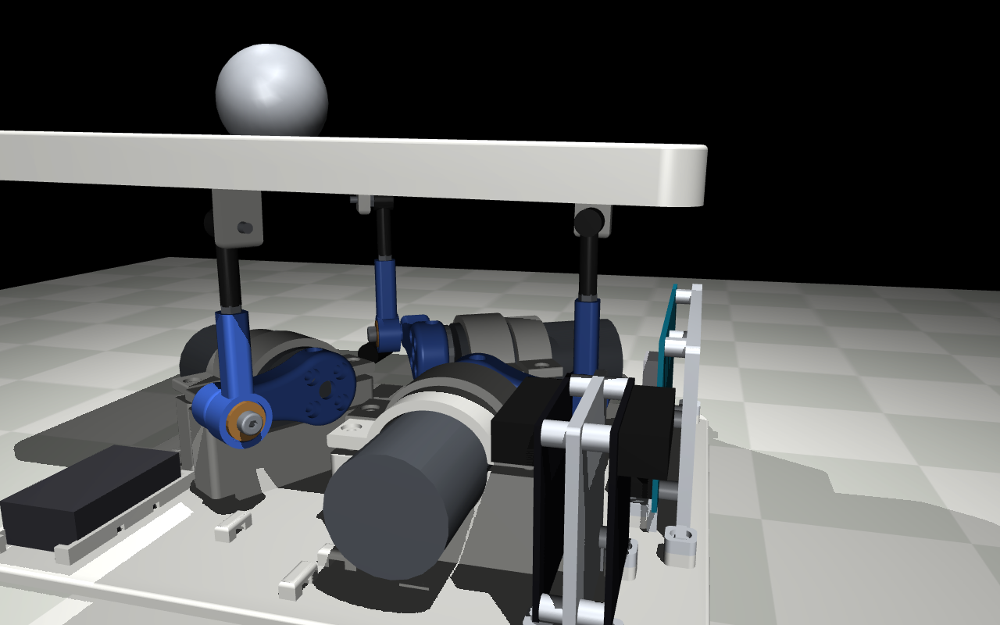
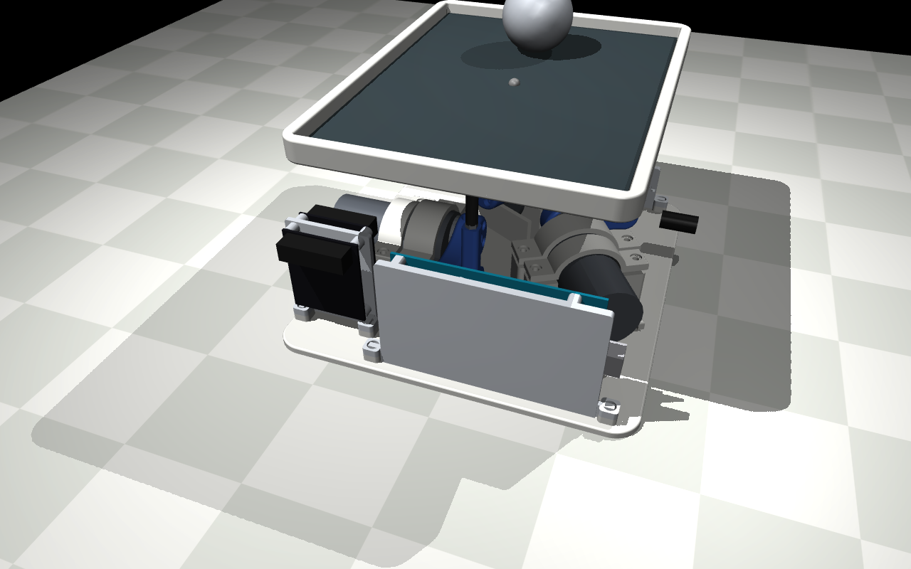

# Best Ball Balancer

**A desk-sized robot that balances a steel ball on a touch screen, silently.**

Three geared motors tilt an 8.4" touch panel; the panel feels where the ball is; an Arduino Mega closes the loop a hundred times a second. It holds the ball dead centre, or steers it around a circle, a figure-8, a square, or a slow random wander.



| | |
|---|---|
| **Build** | [Assembly guide](assembly.md) (animated, step by step) · [Bill of materials](BOM/BOM.md) · [Wiring guide](wiring/README.md) with a [wire-by-wire video](images/assembly/wiring_top.mp4) |
| **Files** | [3D-printable parts](stl/) · [CAD source](CAD/) · [Firmware](code/firmware/balance/balance.ino) · [Simulation](code/sim/) |
| **Power** | 12–20 W from a 12 V wall adapter |
| **Time** | About 40 hours, most of it printing ([breakdown](#time-estimate)) |

---

## Designed to be silent

Most ball balancers use hobby servos or steppers, and you can hear them from across the room: servos buzz while holding position, and steppers whine. This one is designed for a desk you sit at:

- **Geared DC motors** (GA37-520, 30:1) instead of servos or steppers. A gearmotor holding still is quiet.
- **20 kHz PWM**, above the range of human hearing, so the motor drivers don't sing.
- **Encoders on every motor**, so each arm moves smoothly to an exact angle instead of hunting.
- **A damped enclosure:** a Voronoi lattice shell with an optional solid liner that hides the mechanism and soaks up what noise is left.
- **A soft power button** (Pololu pushbutton switch) instead of a clicking toggle.



## How it works



The plate rides on three legs spaced 120° apart: a **3-RRS parallel mechanism**. Each leg is a motor-driven arm, a rod, and a ball joint under the plate. Raising and lowering the three arms tilts the plate in any direction.

Two control loops run on the Mega:

| Loop | Rate | Job |
|---|---|---|
| **Ball loop** | ~70 Hz | Read the ball's position from the resistive panel, filter it, and decide how far to tilt the plate (PID + feed-forward for moving targets). |
| **Motor loop** | 500 Hz | Turn that tilt into three arm angles (inverse kinematics), and drive each motor to its angle using its encoder. |



## The story

### 1. Simulate first

Before buying a single part, the whole machine existed in [MuJoCo](https://mujoco.org/): plate, legs, motors, ball and controller. The simulation picked the geometry (arm length, rod length, leg radius), sized the motors (holding torque, worst-case current), and tuned the first controller. The CAD is generated from the same parameters, so the model and the parts can't drift apart.

### 2. Design every part in code

Every printed part is a [CadQuery](https://cadquery.readthedocs.io/) script. Change a dimension, rerun the build, and every STL, preview and simulation mesh updates together. The parts were iterated many times this way: a two-piece plate (rim and insert) that prints in about an hour instead of eight, spring-preloaded motor straps, bolt-on holders for every board so each can be wired on the bench, and a raised Mega with room for its plugs underneath.

### 3. Bring it up, one piece at a time

Small test sketches proved each subsystem on its own before anything ran together: [encoders](code/firmware/bringup/encoder_monitor/), [motor drive](code/firmware/bringup/drive_test/), [touch panel](code/firmware/bringup/touch_test/), and [homing](code/firmware/bringup/jog_test/).

### 4. Integration hell

Things always go wrong. Some highlights:

- **A dead motor driver.** 12 V went into the 5 V pin of the original TB6612 driver. It was replaced by the sturdier Cytron MDD3A.
- **Motors that went the wrong way, sometimes.** `799 * 45` overflows a 16-bit integer on the Arduino, so "45% counter-clockwise" quietly became "37% clockwise". One `(long)` cast fixed hours of confusion.
- **A homing routine that lied.** The three arms are linked through the plate, so one arm could stop against the plate's weight and look "home" while another was still high. Homing now finishes with a joint push-down.
- **A loose encoder wire.** It came loose twice and sent an arm to full extension. It's glued now, and the firmware rests a motor whose encoder goes silent under full power.
- **"It only shakes when USB is unplugged."** A flight recorder in EEPROM, read back after each unplugged run, ruled out resets, phantom touches and serial noise one by one, then caught the real bug: a "full power" mode meant only for the start-up raise was still switched on while balancing. Fixed, it runs the same with or without USB.
- **The jitter hunt.** A 100 Hz data stream showed three culprits: single-frame glitches from the touch panel (now rejected), a loop that ran 50% slower than it assumed (now measured), and EEPROM writes stalling the motors once a second (removed).

### 5. Tune it

Gains were tuned live over serial, one keypress at a time, then saved. Leg trims level the plate, a feed-forward term with a small lead lets the ball follow moving targets, and a rotation trim cancels sideways drift. The result holds the ball within a few millimetres of centre.



---

## Requirements

**Hardware:** everything is in the [bill of materials](BOM/BOM.md): about $230 of parts plus three GA37-520 gearmotors and two Cytron MDD3A drivers, and about 650 g of PLA/PETG.

**Tools:** a 3D printer (every part fits a 256 mm bed), a soldering iron (about 10 joints), a heat-set insert tip, a multimeter and hex keys.

**Software:**

| For | You need |
|---|---|
| Firmware | [Arduino IDE](https://www.arduino.cc/en/software) or [arduino-cli](https://arduino.github.io/arduino-cli/), board **Arduino Mega 2560** |
| CAD and simulation (optional) | Python 3.12 and [uv](https://docs.astral.sh/uv/) |

## Quick start

**Flash the firmware** (recommended: arduino-cli, which allows a bigger serial buffer so status printing never stalls the motors):

```sh
arduino-cli compile --fqbn arduino:avr:mega \
  --build-property "build.extra_flags=-DSERIAL_TX_BUFFER_SIZE=256" code/firmware/balance
arduino-cli upload --fqbn arduino:avr:mega -p /dev/cu.usbmodem1101 code/firmware/balance
```

From the Arduino IDE, just open [`code/firmware/balance/balance.ino`](code/firmware/balance/balance.ino) and upload; it works without the bigger buffer.

**Power it on.** It homes the arms, raises the plate level, and starts balancing (circle mode) the moment a ball touches the panel.

**Watch the simulation:**

```sh
uv sync
cd code && uv run mjpython -m sim.view      # macOS needs mjpython; elsewhere: python
```

**Rebuild every printed part** after changing a dimension in [`CAD/`](CAD/):

```sh
uv run python -m CAD.build
```

## Time estimate

| Stage | Hours | |
|---|---|---|
| 3D printing | **30** | Mostly unattended. The base plate, frame and shell are the long prints. |
| Wiring | **5** | Lever connectors and Dupont leads; about 10 solder joints in total. Follow the [wiring video](images/assembly/wiring_top.mp4) and the [wiring PDF](wiring/wiring.pdf). |
| Integration hell | **5** | Things always go wrong: a loose wire, a reversed motor, a calibration that needs redoing. Budget for it. |
| **Total** | **~40** | |

## What's in this repo

| Folder | Contents |
|---|---|
| [`stl/`](stl/) | Every printed part, ready to slice |
| [`CAD/`](CAD/) | CadQuery source for every part ([`build.py`](CAD/build.py) exports them all) |
| [`code/firmware/`](code/firmware/) | The balancer firmware, plus four bring-up test sketches |
| [`code/sim/`](code/sim/) | MuJoCo model, controller and interactive viewer |
| [`code/tools/`](code/tools/) | A serial console for live tuning, and the scripts that render the assembly animations and the wiring video |
| [`BOM/`](BOM/BOM.md) | Bill of materials with links |
| [`wiring/`](wiring/README.md) | Wiring guide, diagram and wire list (PDF), and the script that draws it |
| [`assembly.md`](assembly.md) | Step-by-step build guide, with an animation for each stage |
