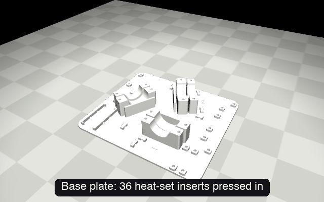
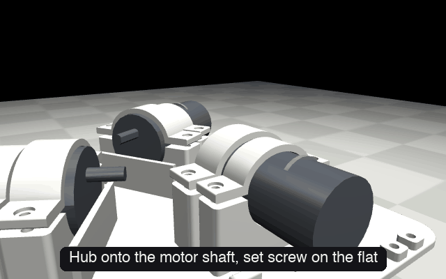
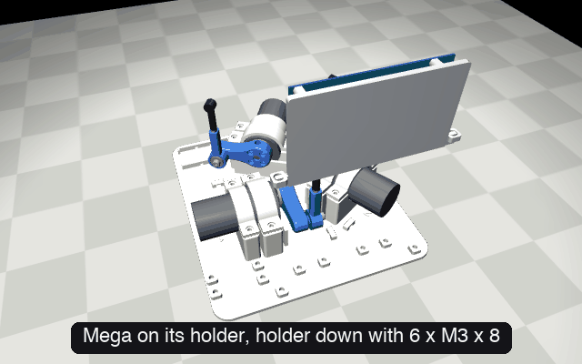
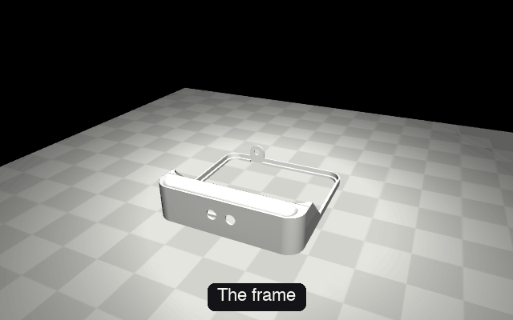

# Assembly guide

Eight stages, from a pile of parts to a balancing ball. Each one has an animation showing the parts going together in order. Keep the [bill of materials](BOM/BOM.md) and the [wiring diagram](wiring/wiring.pdf) open alongside.

| Stage | What | Time |
|---|---|---|
| [1](#1-print-the-parts) | Print the parts | ~30 h (unattended) |
| [2](#2-set-the-heat-set-inserts) | Set the heat-set inserts | 20 min |
| [3](#3-mount-the-motors) | Mount the motors | 30 min |
| [4](#4-build-the-legs) | Build the legs | 45 min |
| [5](#5-mount-the-electronics) | Mount the electronics | 30 min |
| [6](#6-wire-it) | Wire it | ~5 h |
| [7](#7-close-it-up) | Close it up: frame, shell, plate | 30 min |
| [8](#8-bring-it-to-life) | Flash, calibrate, tune | 1–5 h (integration hell) |

---

## 1. Print the parts

All files are in [`stl/`](stl/). PLA is fine everywhere; PETG is better for the arms and rods.

| Part | Qty | Orientation |
|---|---|---|
| [`base_plate`](stl/base_plate.stl) | 1 | Flat, as modelled |
| [`mega_mount`](stl/mega_mount.stl) | 1 | Flat on its back, standoffs up |
| [`driver_mount`](stl/driver_mount.stl) | 1 | Standing up, on its tabs |
| [`switch_mount`](stl/switch_mount.stl) | 1 | Flat on its back |
| [`strap_motor`](stl/strap_motor.stl), [`strap_gearbox`](stl/strap_gearbox.stl) | 3 each | Arch up |
| [`arm`](stl/arm.stl) | 3 | Flat |
| [`rod`](stl/rod.stl) | 3 | Standing up |
| [`plate_insert`](stl/plate_insert.stl) | 1 | Flat, nubs up |
| [`plate_rim`](stl/plate_rim.stl) | 1 | Flat |
| [`frame`](stl/frame.stl) | 1 | Open side down, supports under the console top |
| [`lattice_shell`](stl/lattice_shell.stl) | 1 | Top face down |
| [`liner`](stl/liner.stl) (optional) | 1 | Top face down |

## 2. Set the heat-set inserts

Press **36 M3 inserts** with a soldering iron and insert tip, flush with the surface:

- **Base plate:** 12 in the motor saddles (two beside each strap) and 12 in the raised pads the board holders screw onto.
- **Mega holder:** 6 in its standoffs.
- **Arms:** 1 in each elbow tip.
- **Rods:** 1 in each top face.

The MDD3A standoffs on the driver holder don't take inserts: their M3 screws tap straight into the plastic.

## 3. Mount the motors



1. Lay each motor in its two saddles, gearbox face against the lip, so the shaft points along its leg. Each motor's number (**1**, **2**, **3**) is moulded into the floor under it.
2. Fit the **gearbox strap** and the **motor strap**, each with two **M3 × 12** screws.
3. Tighten until the strap's ears touch the saddle. The straps are deliberately flat: when they're snug on the motor, the ears still sit about 2.5 mm high, so tightening springs them down and clamps the motor firmly. A motor that can shift in its saddle makes the plate imprecise. The screws sit far enough from the arch to get a wrench on them.

## 4. Build the legs



Each leg goes together on its motor, in this order:

1. **Hub onto the shaft.** Slide the flange coupling onto the motor's D-shaft and tighten its set screw onto the flat.
2. **Arm onto the hub.** Fit the arm over the coupling's flange and bolt it on with four **M3 × 12** screws.
3. **Bushing into the rod.** Heat-press the flanged bronze bushing into the rod's elbow eye, from the side the bolt head will be on.
4. **Rod onto the arm.** Pass a **shoulder bolt** through the bushing and thread it into the arm's elbow insert. The rod should swing freely with no play.
5. **Rod end.** Thread an **M3 × 16 grub screw** into the rod's top insert and lock it with an **M3 nut**, then screw the **tie-rod end** socket onto it.

> **Tip:** draw a line across the shaft, coupling and arm with a marker. If an arm ever slips on its shaft, you'll see it immediately.

## 5. Mount the electronics



Every board has its own printed holder. **Screw each holder down first** with **M3 × 8** screws into the pads on the base plate (some of the screws sit under where the board goes), then mount its board.

1. **Arduino Mega:** screw it to its holder with six **M3 × 6** screws, USB end toward the back. It stands 9 mm off the floor so the plugs on its bottom header have room. Use a **right-angle USB-B cable**: there isn't room for a straight plug with the shell on.
2. **Motor drivers:** stick **4 heatsinks** on each MDD3A, one on each of the four small 8-pin chips beside the terminal blocks (the tape comes on them). Then screw the boards back to back onto the driver holder, one on each face, with four **M3 × 8** screws each (they self-tap into the printed posts): terminal blocks up, input header down.
3. **Power switch:** stick the **Pololu** board onto its holder plate with double-sided foam tape, terminals facing out, and loop a zip tie through the two slots and across the board. It sits by the left wall, facing the centre, close to the power jack.
4. **Buck converter:** drop it into its tray and strap it down with a zip tie through the two slots.

## 6. Wire it

https://github.com/user-attachments/assets/843bd77f-8e50-462b-997f-23ea67aadc6e

The **wiring video** (about 4¾ min, top-down) draws every one of the 56 connections in order, 5 seconds each, naming both ends. Follow along with the [wiring diagram](wiring/wiring.pdf), which has every connection on one page per subsystem and a wire list by part. More in the [wiring guide](wiring/README.md).

- **Power and ground** run through lever connectors, one bus each for +12 V, +5 V and ground.
- **Signals** are Dupont leads straight onto the Mega's pins.
- **Soldering** is only needed on the Pololu power switch (its two terminal blocks and a few pins).

Before connecting the motors, power it once and check with a meter: 12 V on the +12 V bus and 5.0 V on the +5 V bus.

> **Never** connect 12 V to a driver's or the Mega's 5 V pin.

## 7. Close it up



1. **Buttons:** push the two buttons in through the console face (red POWER on the left, blue MODE on the right) and tighten their nuts from behind.
2. **Jack:** fit the barrel jack into the frame's back tab from outside.
3. **Base into the frame:** lower the wired base into the frame.
4. **Shell:** lower the liner (optional) and the lattice shell over the mechanism, with the three rods coming up through the slots in the top.
5. **Plate:** slot the insert into the rim (it rests on the rim's step) with a few drops of super glue. Feed the panel's tail down through the slot in the insert, fold it back flat under the two clips, and lay the glass in.
6. **Plate onto the joints:** screw the plate's three nubs onto the ball joints.
7. **Ball:** set the ball on the panel, and the spare in the console dish.

## 8. Bring it to life

### Flash the firmware

See [Quick start](README.md#quick-start). Optional first: the four [bring-up sketches](code/firmware/bringup/) test the encoders, motor directions, touch panel and homing one at a time.

### First power-up

Power on. The balancer will:

1. **Home:** each arm creeps down until it stops against the base, then all three push down together to seat the plate.
2. **Raise:** the arms lift the plate to level.
3. **Balance:** the moment a ball touches the panel, it starts steering the ball (circle mode by default).

### Talk to it

Connect over USB at 115200 baud. The easiest way is the console: it finds the Mega, unlocks the keys, shows the live status and logs it to `console.log`. Type a key and press Return.

```sh
uv run python code/tools/console.py
```

In the Arduino Serial Monitor instead, set **No line ending** and send `~balancer-hello~` once to unlock the keys.

| Key | Does |
|---|---|
| `n` | Next pattern: centre, circle, figure-8, square, wander |
| `P` `p` / `I` `i` / `D` `d` | Raise / lower each gain by 15% (`v` shows them) |
| `1` `2` `3` / `!` `@` `#` | Raise / lower one leg's trim by 0.5° |
| `a` `f` / `w` `z` | Move the target centre ±3 mm (toward / away from motor 1, toward motor 2 / motor 3) |
| `l` / `b` / `s` | Level the plate / balance / stop all motors |
| `home` | Home again (in the Serial Monitor: send a newline) |

### Calibrate

1. **Panel axes:** rest the ball (by its own weight, not held down) over motor 1 and send `k1`; repeat for `k2` and `k3`. This sets which way is which and where the centre is.
2. **Level:** with the ball parked at the centre, watch the tilt in the status line. If the plate has to lean to hold it there, trim the legs with `1` `2` `3` until it doesn't.
3. **Gains:** start from the saved values. If it overshoots, raise D; if it's lazy at the edges, raise P; if it settles off-centre, raise I a little.

Once you like a setting, write it into [`balance.ino`](code/firmware/balance/balance.ino) and upload: live changes last until power-off.

### When things go wrong

| Symptom | Likely cause |
|---|---|
| An arm runs to full extension | Loose encoder wire: reseat it, then glue it |
| An arm goes the wrong way | Motor leads swapped on the driver (M+ / M−) |
| The plate leans with the ball at centre | Leg trims (`1` `2` `3`), or an arm slipping on its shaft |
| Jitter near the edges | Ball is beyond the panel's active area; keep patterns inside it |
| The ball "isn't seen" | Panel tail wires: A0–A3, see the wiring diagram |
| A motor driver runs hot | Check its heatsinks are on; run without the liner for more airflow |
