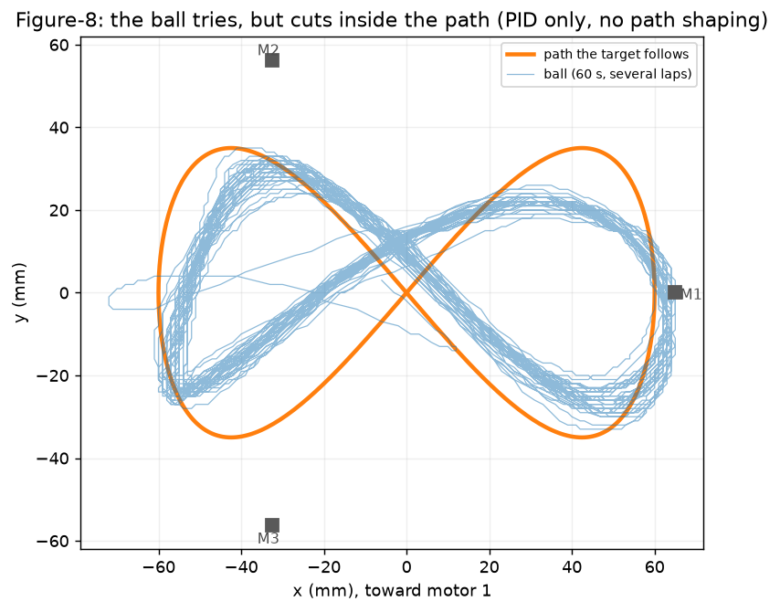
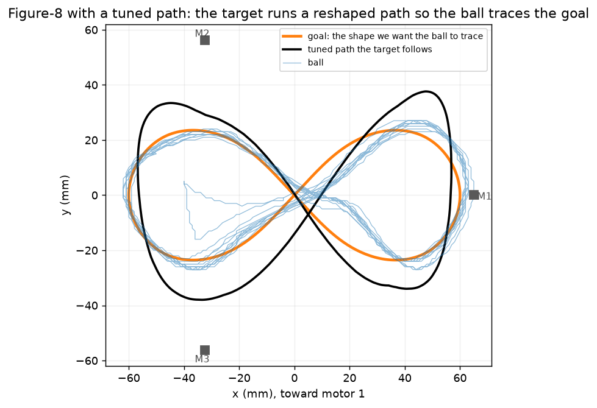

# Tuning

Everything here is done live over USB while the ball rolls: no reflashing. Settings are kept with
`save` (in the Mega's EEPROM, through power-off and through firmware updates).

**One thing to know first: the ball never follows a path exactly, however well the PID is tuned.** It
cuts inside: a circle comes out smaller and slightly triangular (it cuts in over each leg), and a
figure-8's loops pull in. Tuning the PID gets you most of the way; the rest is done by reshaping the path
the target follows (see [Tune the paths](#4-tune-the-paths)).

1. [Connect](#1-connect)
2. [Set the centre](#2-set-the-centre)
3. [Tune the PID](#3-tune-the-pid)
4. [Tune the paths](#4-tune-the-paths)
5. [Before flashing](#5-before-flashing)

All the console commands, with what each does: [code/tools/README.md](code/tools/README.md).

## 1. Connect

```sh
uv run python code/tools/console.py         # terminal 1: holds the USB port, prints the log, sends what you type
uv run python code/tools/viz.py             # terminal 2 (optional): live top-down view
```

- **Opening the port resets the Mega:** it homes and raises again. Keep the console open while you tune;
  the visualizer and the path tool talk through it, so they don't reset anything.
- **Typing:** a word and a value (`kp 6.5`) is a setting; a single character is a key (`n` next pattern,
  `?` ball position, `s` stop); `get` prints every setting; `save` keeps them.
- **Pattern:** `mode centre` (or `circle`, `figure-8`, `square`, `wander`), the visualizer's buttons, or
  the MODE button.

## 2. Set the centre

The panel's centre isn't exactly the plate's centre, so tell the firmware where the plate's real centre
reads on the panel:

1. `mode centre`.
2. Hold the ball still at the plate's physical centre (measure it, or use the rim's midpoints).
3. Type `?` a few times. It prints where the panel puts the ball, e.g. `ball 20, -16 mm`.
4. Set the centre to that: `cx 20`, `cy -16`. Let go: the ball should now settle in the middle.
5. `save`.

`cx` / `cy` are in mm, in the plate's frame (+x toward motor 1). The keys `a` `f` / `w` `z` nudge them
3 mm at a time. This build's values (21, −15) are the firmware defaults; yours will differ.

**Level the plate first** if it leans with the ball at the centre: `t1` `t2` `t3` set each leg's trim in
degrees up. An inclinometer on the plate, pointing at each motor, gives the numbers: raise the low legs
(1° of trim lifts that corner about 0.6 mm).

## 3. Tune the PID

The ball loop is a PID controller: it looks at where the ball is and how fast it's moving, and decides
how far to tilt the plate.

| Gain | Command | What it does | Too low | Too high | Default |
|---|---|---|---|---|---|
| **P** | `kp` | Tilts harder the further the ball is from its target | Lazy: drifts to the edges | Overshoots, circles the centre | 6.08 |
| **I** | `ki` | Builds up tilt to cancel a steady lean | Rests a few mm off target | Slow, swinging overshoot | 9.23 |
| **D** | `kd` | Brakes the ball in proportion to its speed | Overshoots, wobbles | Twitchy plate | 3.02 |
| Motor damping | `md` | How firmly each arm settles on its angle | Arms ring | Plate buzzes | 5.0 |
| Feed-forward lead | `lead` (ms) | How early a moving pattern's turns are anticipated | Ball lags the path | Ball cuts ahead | 80 |
| Tilt rotation | `rot` (deg) | Turns the tilt command, to cancel a sideways drift | | | −8 |

Type a value (`kd 3.5`), or use the keys: `P` `p`, `I` `i`, `D` `d`, `M` `m` change one by 15%
(`0` turns I off), `>` `<` change the lead, `[` `]` the rotation. `v` shows them all, with loop timing.

1. In `mode centre`, **turn I off** (`ki 0`) to see P and D on their own.
2. **Raise P** until the ball comes back briskly from the edge, even if it overshoots a little.
3. **Raise D** until a push settles with one small overshoot and no wobble. Too much D makes the plate
   twitch.
4. **Bring I back** until the ball settles right on target.
5. **Test it moving:** `mode circle`. If the ball lags behind the target, raise `lead`; if it drifts
   sideways along straight runs, change `rot` a couple of degrees.
6. `save`.

| Symptom | Try |
|---|---|
| Ball orbits or oscillates around the centre | D up, or P down |
| Weak at the edges, the ball reaches the rim | P up |
| Settles a few mm off centre | I up, re-level (`t1`–`t3`), or re-set the centre |
| Plate twitches or buzzes at rest | D down, or `md` down |
| Jumps right at the panel's edges | Keep patterns inside the panel: readings get unreliable at the very edge |

## 4. Tune the paths

Even with good gains the ball doesn't trace the pattern. Before (target on the plain figure-8, orange;
the ball over several laps, blue):



What we tried:

| Approach | Result |
|---|---|
| **More PID tuning** | Only gets you so far. On the circle the ball held a 36 mm radius on a 45 mm path, with a three-lobe wobble (narrowest over each leg). |
| **Learning** (`ilc 1`: each lap's error is fed back into the target) | Works: the circle's error fell from about 9 mm to 3 mm in 5 laps. But the plate gets **loud**: the learned shape picks up noise and the plate twitches. It also diverged once. |
| **Tuned paths** | **The easiest and quietest.** The target runs a hand-reshaped path, larger where the ball cuts in, so the ball traces the shape you want. The motion stays smooth because the path is fixed. |

After (target on the tuned path, black; the goal shape, orange; the ball, blue). The ball is on average
3 mm off the goal, 90% of the time within 7 mm:



The firmware ships with this build's tuned circle and figure-8. Your build will differ a little, so
check them and retune if the ball misses.

### The visualizer

```sh
uv run python code/tools/viz.py
```

A live top-down view of the plate, from the firmware's 50 Hz ball/target stream:

| On screen | Meaning |
|---|---|
| **Orange line** | The goal: the shape the ball should trace |
| **Black line** | The path the target follows (the tuned shape) |
| **Red ×** | The target right now; the dotted line joins it to the ball |
| **Blue dot and trail** | The ball, and everywhere it has been since you pressed **Reset trail** |
| **M1–M3** | The three legs |
| Buttons on the left | Switch pattern |

The title shows the ball, the target and how far apart they are. Let the ball run a dozen laps and the
trail shows where it consistently misses: that's what to correct.

### Reshape a path

```sh
uv run python code/tools/shape.py export figure-8          # -> code/tools/paths/figure-8_paths.csv
uv run python code/tools/shape.py load figure-8 my_edit.csv
```

1. **Export** the pattern. The CSV has one row per degree of the lap: `target_path_x_mm`,
   `target_path_y_mm` (the path the target follows) and `goal_x_mm`, `goal_y_mm`.
2. **Edit** the target path in a spreadsheet or a script: push it **out** where the ball cuts in, by
   about how far it cuts in. Keep it smooth; sharp corners make the plate jerk.
3. **Load** it. Loading **parks the arms first** and leaves them parked (a path changed while the plate
   moves jumps the target and throws the ball). Then type `home`.
4. Reset the visualizer's trail and watch a dozen laps. Repeat from 2.
5. `save` when it's right. Each pattern keeps its own shape.

The circle's shape is also eight numbers (`h1c` … `h4s`: how its radius changes round the lap) plus
its average radius (`ax`, `ay`), handy for small tweaks by hand. `ax` `ay` `per` set any pattern's size
and period.

**A different goal shape:** the orange goal is the plain pattern unless a drawn one is listed in
`GOAL_FILES` at the top of [`viz.py`](code/tools/viz.py). The figure-8's is
[`figure8_ideal_goal_path.csv`](code/tools/paths/figure8_ideal_goal_path.csv) (120 × 47 mm).

## 5. Before flashing

Type **`park`** first: the arms come down slowly onto their stops and the motors switch off. Flashing
resets the Mega, which drops the plate at once, and a 1.5" steel ball is heavy enough to damage things
nearby. Close the console (Ctrl-C) so the upload can use the port. Saved settings survive the upload.
