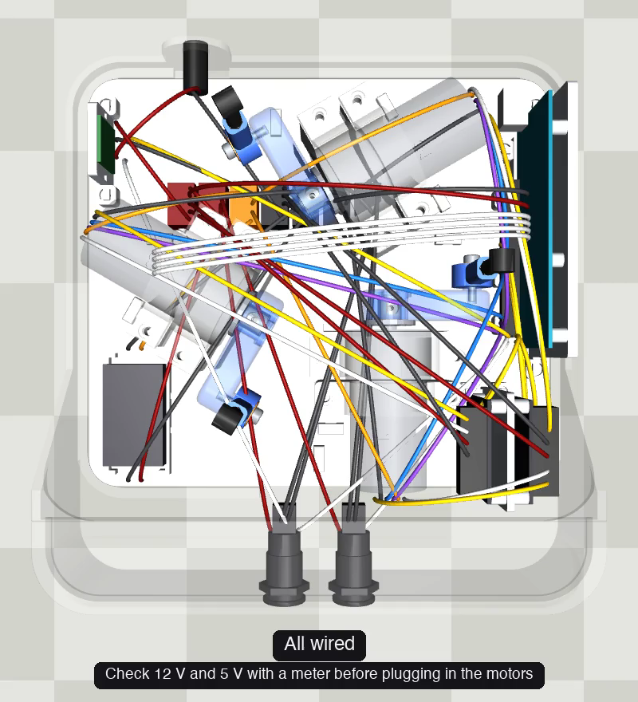

# Wiring

Everything you need to wire the balancer: 56 connections between the power jack, the soft power switch, the Wago lever connectors, the Arduino Mega, two motor drivers, three motors, the touch panel and the two buttons.

## Watch it first

[](../images/assembly/wiring_top.mp4)


https://github.com/user-attachments/assets/843bd77f-8e50-462b-997f-23ea67aadc6e

 (7½ min, top-down). Every connection is drawn in order, 8 seconds each, with both ends named and the wire type below. Earlier wires stay faint so the current one stands out. Pause it, make that connection, play on.

The Wago buses are colour-coded in the video: **dark red** = +12 V, **orange** = +5 V, **black** = ground.

## The files

| File | What it is |
|---|---|
| [`wiring.pdf`](wiring.pdf) | **Print this.** The diagram: one page each for power (every Wago port), motors and encoders, and the touch panel, buttons and soft power, then a wire list by part. |
| [`wiring.html`](wiring.html) | The same diagram as an interactive web page. Download it and open it in a browser: hover any wire to highlight its two ends. |
| [`wiring.py`](wiring.py) | The source. One list, `CONNECTIONS`, holds every wire: from, to, and wire type. Running it draws `wiring.html`; the PDF is printed from that page, and the [wiring video](../code/tools/wiring_anim.py) reads the same list. Change a connection here and everything follows. |

To regenerate after editing a connection:

```sh
uv run python wiring/wiring.py                           # -> wiring/wiring.html
cd code && uv run python tools/wiring_anim.py            # -> images/assembly/wiring_top.mp4
```

## How it's wired, in brief

- **Power:** 12 V adapter → panel jack → Pololu soft power switch → the +12 V Wagos. A buck converter makes 5 V for the motor encoders. The Mega takes 12 V on VIN and makes its own 5 V.
- **Ground:** every ground goes to the four linked ground Wagos.
- **Motors:** each motor's two power leads go to a driver terminal; its encoder's A and B go to interrupt pins on the Mega (D2/D19, D3/D20, D18/D21).
- **Drivers:** two PWM pins per motor from the Mega (D6/D7, D8/D44, D45/D46), at 20 kHz so they're silent.
- **Touch panel:** its four tail wires go straight to A0–A3.
- **Buttons:** POWER switches the Pololu on and tells the Mega when it's held; MODE goes to D30.

## Before you power it on

- Connect the motors last. Power up once without them and check with a meter: **12 V** on the +12 V Wagos and **5.0 V** on the +5 V Wago.
- **Never** connect 12 V to a driver's or the Mega's 5 V pin.
- Leave both MDD3As' 5V pins unconnected: they're outputs from the boards' own regulators.
- Motor connector pins, left to right: 1 M+ (yellow), 2 GND (black), 3 A (blue), 4 B (purple), 5 5V (red), 6 M− (white).
- Button harness colours vary by batch: check LED+, LED−, C, NO and NC with a meter before connecting.
